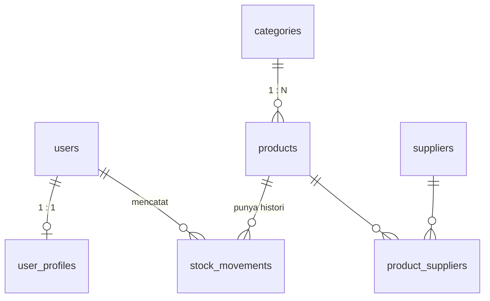

# Mini Project 3: Inventory Management System

Aplikasi inventory sederhana dengan **PHP (PDO) + MySQL**. Pertemuan 4: *Relational Database + Advanced PHP*.

## Cara menjalankan

Kebutuhan: PHP 8.1+ (ekstensi `pdo_mysql`) dan MySQL 8.0.16+ / MariaDB 10.2+.

```bash
mysql -u root -p < database/schema.sql      # buat database + data contoh
php -S localhost:8000 -t public             # jalankan, document root = public
```

Buka <http://localhost:8000/login.php>. Jika user/password MySQL berbeda, ubah `config/database.php` (atau set env `DB_USER`, `DB_PASS`).

**Akun demo:** `admin` / `admin123` · `staff` / `staff123`

## Struktur file

```
inventory-app/
├── config/database.php     koneksi PDO
├── helpers/functions.php   escape, validasi, CSRF, login/role, pagination, layout
├── database/schema.sql     skema + data contoh
└── public/
    ├── login.php  logout.php  dashboard.php
    ├── categories.php      CRUD kategori (admin)
    ├── products.php        daftar produk: search, filter, sorting, pagination
    ├── product_form.php    tambah / edit produk + pilih supplier (admin)
    └── stock.php           barang masuk, barang keluar, histori
```

## Daftar tugas (slide 38) dan lokasinya

| Tugas | File |
|---|---|
| ERD dan `schema.sql` | bagian ERD di bawah, `database/schema.sql` |
| Login dan role admin/staff | `public/login.php`, `helpers/functions.php` |
| Modul kategori dan produk | `public/categories.php`, `public/products.php`, `public/product_form.php` |
| Search, filter, sorting, pagination | `public/products.php` |
| Barang masuk/keluar dengan transaction | `public/stock.php` |
| Dashboard sederhana | `public/dashboard.php` |
| Uji validation error dan akses terlarang | bagian Pengujian di bawah |

## ERD



- **One-to-one:** `users` ↔ `user_profiles` (FK + `UNIQUE`)
- **One-to-many:** `categories` → `products`, `products` → `stock_movements`, `users` → `stock_movements`
- **Many-to-many:** `products` ↔ `suppliers` lewat junction table `product_suppliers` (composite PK)

Kolom utama: `products(id, category_id, sku UNIQUE, name, price, stock, minimum_stock)` dan `stock_movements(id, product_id, user_id, type IN/OUT, quantity, note, created_at)`.

## Penjelasan business rule

Setiap aturan dijaga di PHP (pesan error yang jelas) dan di database (pengaman terakhir).

| Business rule | Di aplikasi | Di database |
|---|---|---|
| SKU harus unik | dicek di `product_form.php` | `sku ... UNIQUE` |
| Harga dan quantity tidak boleh negatif | harga: regex angka ≥ 0; quantity: integer > 0 | `CHECK (price >= 0)`, `CHECK (quantity > 0)` |
| Barang keluar tidak boleh melebihi stok | `stock.php`: `SELECT ... FOR UPDATE`, tolak jika `qty > stock` | tertahan oleh aturan berikutnya |
| Stok tidak boleh negatif | pengecekan di atas; stok tidak bisa diedit manual | `CHECK (stock >= 0)` |
| Produk yang punya histori tidak boleh dihapus | `products.php` menolak hapus; tombol hapus disembunyikan | FK `ON DELETE RESTRICT` |
| Halaman internal butuh login | `require_login()` | — |
| Staff tidak boleh akses administrasi | `require_admin()` → HTTP 403 | — |
| Sorting hanya kolom yang diizinkan | allowlist `$sortable` di `products.php` | — |

**Jika barang keluar, yang berubah:** stok produk berkurang dan satu baris histori `OUT` (lengkap dengan user pencatat) ditambahkan. Keduanya dibungkus satu transaksi:

```
BEGIN → SELECT stock FOR UPDATE → validasi qty <= stock
      → UPDATE products SET stock = stock - qty
      → INSERT stock_movements (type = 'OUT') → COMMIT   (gagal di mana pun → ROLLBACK)
```

Hak akses: **admin** mengelola kategori, produk, dan transaksi. **Staff** hanya melihat produk, mencatat transaksi, dan melihat dashboard.

Keamanan: prepared statement PDO (tanpa concatenation input), validasi server-side, `htmlspecialchars` lewat `e()`, `password_hash`/`password_verify`, `session_regenerate_id(true)`, dan token CSRF di semua form POST.

## Pengujian (untuk screenshot)

**Validation error (minimal 1):**
- Barang Keluar → pilih "Mouse Wireless" (stok 3) → jumlah `10` → muncul *Stok tidak cukup…*
- Tambah Produk dengan SKU `ELK-001` → muncul *SKU sudah dipakai…*

**Akses terlarang (minimal 1):**
- Login sebagai `staff` → buka `/categories.php` atau `/product_form.php` → **403 Forbidden**
- Tanpa login → buka `/dashboard.php` → diarahkan ke halaman login

**Uji keamanan:**
- Kolom cari produk diisi `' OR '1'='1` → dianggap teks biasa, tidak ada produk cocok
- Kategori bernama `<script>alert(1)</script>` → tampil sebagai teks, tidak dieksekusi
- `/products.php?sort=price;DROP TABLE products` → sorting kembali ke default

**Screenshot yang disarankan:** login, dashboard, daftar produk (search/filter/sort/pagination), form produk dengan supplier, barang masuk dan histori, barang keluar ditolak (validation error), staff mendapat 403.
